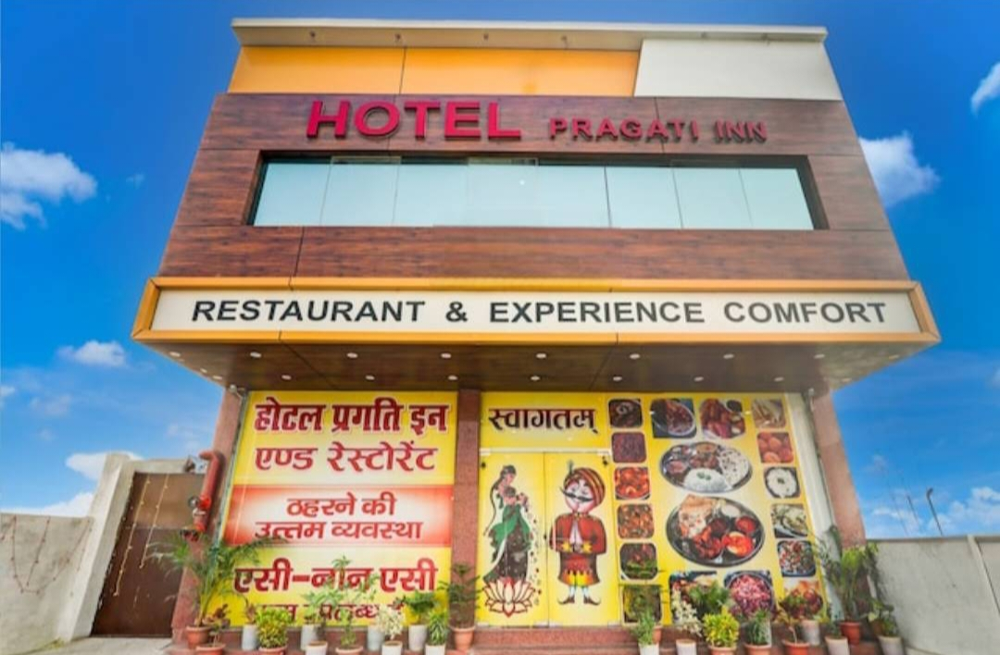

🏨 HOTEL PRAGATI – Hotel Booking & Complete Management System

  

<h2 align="center">HOTEL PRAGATI INN</h2>

  <b>A Complete Full-Stack Hotel Booking, Food Ordering, Inventory & Management System</b>

  Online Room Booking • Food Ordering • UPI Payments • Inventory Management • Stock Tracking • Admin Dashboard

  <b>Designed & Developed by Prabhakar Singh Kshatriya</b>

⸻

🌐 Live Website

  <a href="https://hotel-pragatii-inn.onrender.com/">
    <strong>🚀 VISIT HOTEL PRAGATI LIVE WEBSITE</strong>
  </a>

Explore the live Hotel Pragati website, browse available rooms, submit booking requests, explore the food menu, place food orders and experience the online hotel management system.

Live Website: https://hotel-pragatii-inn.onrender.com/

⸻

📌 About The Project

Hotel Pragati is a full-stack hotel booking and management platform developed to simplify hotel operations and provide customers with a convenient online experience.

The system combines customer-facing hotel services with a separate administrator-only management dashboard.

Customers can explore hotel rooms, submit booking requests, browse the food menu, place food orders and submit UPI transaction details.

Administrators can manage hotel bookings, food orders, room availability, food menus, inventory, stock movements, purchases, expenses, payments, promotional offers, notifications and business reports.

The platform also includes an integrated inventory management system that connects food ordering operations with stock management to improve inventory accuracy and reduce manual work.

The main objective is to provide a centralized, responsive and efficient solution for managing hotel operations.

⸻

✨ Key Features

👤 1. Customer Website

* Responsive hotel website.
* Attractive homepage and hotel information.
* Room booking functionality.
* AC and Non-AC room options.
* Room availability information.
* Online food menu.
* Food ordering system.
* Hindi and English food names.
* Half and Full food item pricing.
* Shopping cart and checkout.
* UPI QR code payment.
* UTR / Transaction ID submission.
* Booking and order notifications.
* Active promotional offers.
* Dynamic pricing and availability.
* Mobile-friendly interface.

🛏️ 2. Room Booking Management

* AC room booking.
* Non-AC room booking.
* Room availability management.
* Customer booking information.
* Booking reference number.
* Booking date and details.
* Payment method selection.
* UPI transaction reference submission.
* Booking status management.
* Admin-side booking management.
* Room price management.
* Room availability updates.

🍽️ 3. Food Ordering Management

* Digital food menu.
* Multiple food categories.
* Hindi and English item names.
* Single-price food items.
* Half and Full pricing options.
* Add-to-cart functionality.
* Quantity management.
* Food checkout system.
* UPI QR payment support.
* UTR submission.
* Customer order information.
* Order status tracking.
* Admin-side food order management.
* 15-minute food preparation/wait information.

📦 4. Advanced Inventory Management

An integrated inventory management system helps administrators manage hotel ingredients, stock quantities and food-related inventory operations.

Inventory Operations

* Add new inventory items.
* Update inventory information.
* Delete inventory items.
* Manage stock quantities.
* Track available stock.
* Manage inventory units.
* Configure minimum stock levels.
* Monitor low-stock items.
* Maintain inventory records.
* Track stock adjustments.

Stock Management

* Automatic stock deduction for applicable food orders.
* Stock adjustment functionality.
* Stock addition and reduction.
* Inventory quantity validation.
* Prevention of invalid stock deductions.
* Stock availability verification.
* Stock consistency during order processing.

Atomic Stock Management

The inventory service includes transaction-based stock operations to improve data consistency.

* Atomic inventory updates.
* MongoDB transaction-based stock operations.
* Session-based database operations.
* Stock validation before deduction.
* Prevention of overselling due to concurrent stock updates.
* Rollback support when transactional operations fail.
* Consistent stock updates during food order processing.

Food Recipe & Ingredient Validation

* Recipe-based ingredient validation.
* Ingredient availability checks.
* Stock requirement calculations.
* Inventory validation before applicable food order operations.
* Improved coordination between food orders and inventory.

Order Stock Tracking

* Stock deduction snapshots associated with food orders.
* Tracking inventory deductions.
* Order status transition validation.
* Controlled stock-related order updates.
* Improved inventory traceability.

🛒 5. Purchase Management

Purchase management helps administrators maintain records of inventory purchases.

Features include:

* Add purchase records.
* Update purchase details.
* Delete purchase records.
* Manage purchased inventory quantities.
* Maintain purchase information.
* Track purchase-related expenses.
* Integrate purchase operations with inventory management.

💰 6. Expense Management

* Add expense records.
* Update expenses.
* Delete expenses.
* Maintain expense information.
* Track hotel operating expenses.
* Organize financial records.
* Support financial reporting.

🔔 7. Notifications Management

* Admin dashboard notifications.
* Food order-related notifications.
* Inventory-related alerts.
* Low-stock notifications.
* Management activity notifications.
* Improved visibility of important hotel operations.

💳 8. Payment Management

The platform supports UPI QR-based payment submission and administrator-side transaction verification.

Features include:

* UPI QR code payments.
* Customer transaction ID submission.
* Payment verification by administrator.
* Pending payment tracking.
* Paid and unpaid status management.
* Payment verification timestamps.
* Separate booking and food-order payment handling.

Important: Submitting a UTR or transaction reference does not automatically confirm payment. Administrators must verify the submitted transaction.

🔐 9. Admin Dashboard

A separate administrator-only dashboard provides centralized control over hotel operations.

Dashboard Management

* Secure administrator login.
* Dashboard overview.
* Booking management.
* Food order management.
* Inventory management.
* Purchase management.
* Expense management.
* Room management.
* Room availability management.
* Room price management.
* Food menu management.
* Food category management.
* Offers management.
* Payment verification.
* Customer information management.
* Order status management.
* Admin notifications.
* Reports and analytics.

Inventory Dashboard

* Inventory item management.
* Stock quantity monitoring.
* Stock adjustments.
* Purchase records.
* Low-stock monitoring.
* Inventory-related notifications.
* Food-order inventory integration.

Financial Management

* Purchase tracking.
* Expense tracking.
* Booking revenue information.
* Food order revenue information.
* Payment summaries.
* Financial reporting.

🎁 10. Offers & Discounts Management

* Create promotional offers.
* Update offer details.
* Activate and deactivate offers.
* Manage discount information.
* Display active offers on the customer website.
* Apply eligible offers to booking calculations.
* Apply eligible offers to food-order calculations.

📊 11. Reports & Analytics

The admin dashboard provides reporting functionality to help administrators monitor hotel operations.

* Booking reports.
* Food order reports.
* Inventory information.
* Purchase records.
* Expense records.
* Revenue information.
* Payment summaries.
* Daily reports.
* Custom date-range reports.
* Booking statistics.
* Food order statistics.
* Business performance information.

⸻

🛠️ Technology Stack

Frontend

* HTML5
* CSS3
* JavaScript
* Responsive Web Design

Backend

* Node.js
* Express.js
* REST APIs

Database

* MongoDB
* Mongoose ODM

Security

* JWT Authentication
* bcryptjs
* Helmet
* CORS
* Express Rate Limit
* Environment Variables

Validation

* Zod
* Server-side validation
* Inventory stock validation
* Food order validation

Payment

* UPI QR Code
* UTR / Transaction Reference Verification

Deployment & Version Control

* Git
* GitHub
* Render

⸻

🏗️ System Architecture

The application follows a full-stack architecture.

Customer Website

Customers interact with the frontend to access room booking, food ordering and payment submission functionality.

Backend API

The Node.js and Express backend handles application logic, authentication, booking operations, food orders, inventory operations, payments and administrative requests.

Database

MongoDB stores application data, including bookings, food orders, inventory items, purchases, expenses and other management records.

Admin Dashboard

Administrators access protected management functionality through a separate dashboard.

⸻

📂 Project Structure

hotel-pragati/
│
├── admin/
│   ├── login.html
│   └── dashboard.html
│
├── backend/
│   ├── config/
│   ├── middleware/
│   ├── models/
│   │
│   ├── routes/
│   │   ├── food.js
│   │   ├── inventory.js
│   │   └── ...
│   │
│   ├── utils/
│   │   └── inventoryService.js
│   │
│   └── ...
│
├── css/
│   └── style.css
│
├── js/
│   ├── config.js
│   └── ...
│
├── images/
│   └── Main.jpeg
│
├── index.html
├── server.js
├── package.json
├── package-lock.json
└── README.md

Note: This represents the main project components. Additional files and folders may exist in the repository.

⸻

⚙️ Installation & Setup

Follow these steps to run Hotel Pragati locally.

1. Clone Repository

git clone https://github.com/PrabhakarSinghKshatriya/HOTEL-PRAGATII-INN.git

2. Navigate to Project

cd HOTEL-PRAGATII-INN

3. Install Dependencies

npm install

4. Configure Environment Variables

Create a .env file in the project root directory.

Configure the required environment variables according to the backend configuration.

Example:

PORT=5000
MONGODB_URI=your_mongodb_connection_string
JWT_SECRET=your_secure_jwt_secret

Add any other variables required by the application, including payment or notification configuration where applicable.

Security Notice:

* Never upload .env files to GitHub.
* Never expose MongoDB credentials.
* Never expose JWT secrets.
* Keep private API keys secure.

5. Start the Application

npm start

For development:

npm run dev

6. Open the Website

Run the customer-facing website using a local development server if required by the project configuration.

Example:

npx http-server . -p 8080

Visit:

http://localhost:8080

⸻

🌐 Deployment

Hotel Pragati is deployed using Render.

Live Application

https://hotel-pragatii-inn.onrender.com/

GitHub Repository

https://github.com/PrabhakarSinghKshatriya/HOTEL-PRAGATII-INN

Deployment Technologies

* GitHub for source code management.
* Render for application hosting.
* MongoDB for database management.

The application can be updated through GitHub commits and deployed through the configured Render deployment workflow.

⸻

🔒 Security & Data Consistency

The application incorporates several security and data consistency measures.

* Separate administrator login.
* Protected administrative operations.
* JWT-based authentication.
* Password hashing.
* Secure environment variables.
* Server-side validation.
* Payment verification workflow.
* Restricted administrative operations.
* MongoDB-backed application data.
* Atomic inventory update operations.
* Transaction-based stock management.
* Food order validation.
* Controlled order status transitions.

⸻

📱 Responsive Design

The customer-facing website is designed to support:

* Desktop computers.
* Laptops.
* Tablets.
* Android smartphones.
* iPhones.

The interface focuses on providing a convenient experience across different screen sizes.

⸻

🚀 Future Enhancements

Potential future improvements include:

* Online payment gateway integration.
* Automated booking confirmations.
* Advanced inventory analytics.
* Automated purchase management.
* Advanced financial reporting.
* Customer booking history.
* Automated payment reconciliation.
* Enhanced notification system.
* Advanced hotel performance analytics.

⸻

👨‍💻 Developer

Prabhakar Singh Kshatriya

Full-Stack Web Developer

GitHub:

https://github.com/PrabhakarSinghKshatriya

⸻

📄 License

This project is developed for Hotel Pragati.

All rights reserved unless otherwise specified by the repository owner.

⸻

  <h2 align="center">🏨 HOTEL PRAGATI INN</h2>
  

    <b>Your Comfort, Our Priority.</b>
  

  

    <a href="https://hotel-pragatii-inn.onrender.com/">
      🚀 Visit Live Website
    </a>
  

   
  

    <b>Developed & Managed By Prabhakar Singh Kshatriya</b>
  

